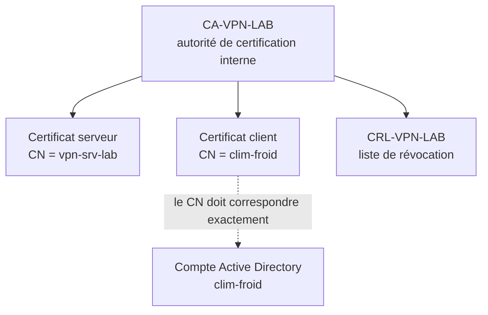

# VPN, PKI et authentification mutuelle

> Les noms de domaine, de machines, de comptes et de tiers qui apparaissent ici sont fictifs. Les captures proviennent d'un laboratoire.

## L'objectif

Remplacer un accès RDP ouvert sur Internet par un accès en deux temps : d'abord un tunnel chiffré qui exige deux facteurs, ensuite la session RDP à l'intérieur de ce tunnel.

Le résultat visé est simple à énoncer. Le port 3389 ne doit plus jamais répondre depuis Internet, et le prestataire doit pouvoir travailler exactement comme avant.

## Pourquoi deux facteurs, et lesquels

Un mot de passe seul ne suffit pas : il se devine, se rejoue, se retrouve dans une fuite. Un certificat seul ne suffit pas non plus : il se copie si le poste est compromis.

Le serveur VPN est donc configuré en mode **Remote Access (SSL/TLS + User Auth)**, ce qui exige les deux simultanément :

- un **certificat client** émis par une autorité de certification interne ;
- le **mot de passe du compte de domaine** du prestataire.

S'il en manque un, la connexion est refusée. Sans exception.

## L'infrastructure de certificats

J'ai créé une autorité de certification dédiée au VPN, puis deux certificats signés par elle : un certificat serveur installé sur le pare-feu, et un certificat client exporté vers le poste du prestataire.



L'autorité est la racine de confiance : seuls les certificats qu'elle a signés sont acceptés.

**Le point important est le lien entre le certificat et le compte.** Le CN du certificat client est exactement le nom d'ouverture de session du compte Active Directory. Cette correspondance est ce que l'option *Strict User-CN Matching* vérifie à chaque connexion.

Sans elle, quelqu'un qui détient un certificat valide pourrait l'utiliser avec les identifiants d'un autre utilisateur. Les deux facteurs seraient présents, mais ils ne parleraient pas de la même personne.

## Le compte du prestataire

Le compte a été créé dans l'annuaire avec des droits volontairement pauvres : aucun droit d'administration, aucun accès aux partages réseau, aucune ouverture de session locale sur le serveur.

Son unique fonction est de s'authentifier au VPN et d'ouvrir une session RDP sur le serveur applicatif pour atteindre le logiciel de gestion du froid. La politique de mot de passe du domaine s'y applique automatiquement.

> *Capture : console Active Directory, propriétés du compte clim-froid*

## Paramètres cryptographiques

| Paramètre | Valeur | Pourquoi |
|---|---|---|
| Chiffrement des données | AES-256-GCM | Algorithme AEAD : chiffre et authentifie en une opération, recommandé par l'ANSSI |
| Repli | AES-256-CBC | Uniquement pour un client qui ne sait pas négocier l'algorithme. N'est pas utilisé en fonctionnement normal |
| Authentification des paquets | SHA-256 | Signature des paquets du canal de données |
| Échange de clés | Diffie-Hellman 4096 bits | Négociation de la clé de session |
| Version TLS minimale | TLS 1.2 | Imposée par l'option `tls-version-min 1.2` |
| Signature des certificats | SHA-512 | Algorithme de signature de l'autorité et des certificats émis |
| Options de contrôle | Strict User-CN Matching, validation du Key Usage du certificat client | Voir ci-dessous |

**Deux digests différents, et ce n'est pas une incohérence.** SHA-512 signe les certificats, SHA-256 authentifie les paquets du tunnel. Ce sont deux usages distincts : le premier garantit que le certificat vient bien de l'autorité, le second garantit qu'un paquet n'a pas été modifié en transit.

**Pourquoi le paramètre Diffie-Hellman compte ici.** Avec TLS 1.2 autorisé, l'échange de clés peut emprunter le Diffie-Hellman classique, et la taille du paramètre détermine la solidité de cette négociation. 4096 bits est un choix large.

Ce serait différent avec TLS 1.3 comme minimum : cette version a retiré le Diffie-Hellman classique du protocole au profit de groupes éphémères négociés dans le handshake, et le fichier de paramètres cesserait d'être utilisé. Annoncer TLS 1.3 et un paramètre DH comme deux mesures distinctes serait donc contradictoire.

**Validation du Key Usage.** Un certificat porte une indication de l'usage auquel il est destiné. Sans cette vérification, un certificat serveur pourrait être présenté comme certificat client. L'option impose que le certificat présenté porte bien l'usage *TLS Web Client Authentication*.

Ces deux options se complètent : la première vérifie *qui* se connecte, la seconde vérifie *avec quoi*.

> *Capture : configuration du serveur VPN, mode SSL/TLS + User Auth, AES-256-GCM, Strict User-CN Matching et validation du Key Usage activés*

## Adresse fixe pour le prestataire

Un *Client Specific Override* attribue au compte du prestataire la même adresse IP à chaque connexion, `10.10.0.2`.

Ce n'est pas un confort. C'est la condition de l'étape suivante : la règle de filtrage ne peut autoriser une source précise que si cette source est prévisible. Sans adresse fixe, il faudrait ouvrir tout le sous-réseau du VPN, et le moindre privilège disparaîtrait.

> *Capture : Client Specific Override, utilisateur clim-froid, IP 10.10.0.2*

## Révocation

Une liste de révocation a été créée et associée au serveur VPN.

Si le poste du prestataire est perdu, volé ou compromis, il suffit de révoquer son certificat pour couper l'accès immédiatement. Sans toucher aux règles de filtrage, sans désactiver le compte, sans aucune autre intervention sur l'infrastructure.

C'est la différence entre un accès qu'on peut retirer en une opération et un accès qu'il faut démanteler. Quand l'incident arrive, cette différence se compte en minutes.

> *Capture : CRL associée au serveur VPN*

## Preuve : la connexion complète

Le prestataire ouvre son client VPN avec son certificat et son mot de passe, reçoit l'adresse attendue, puis lance sa session RDP vers le serveur applicatif à l'intérieur du tunnel.

Le journal de connexion montre chaque étape du handshake :

```
VERIFY OK: depth=0, CN=clim-froid
TLS: Username/Password authentication deferred...
user 'clim-froid' authenticated successfully
MULTI_sva: pool returned IPv4=10.10.0.2
Initialization Sequence Completed -- connected
Data Channel: cipher 'AES-256-GCM'
filterlog: pass TCP 10.10.0.2 -> 10.0.0.150:3389
```

Les lignes se lisent dans l'ordre des contrôles : le certificat est vérifié d'abord, le mot de passe ensuite, l'adresse est attribuée, le canal chiffré s'établit, et c'est seulement alors que le premier paquet RDP passe le filtre.

> *Capture : journal de connexion VPN complet*
> *Capture : session RDP ouverte depuis le poste du prestataire*

## Preuve : un seul port ouvert

Un balayage depuis une machine Kali confirme que le seul port joignable depuis Internet est celui du VPN. Le port 3389 ne répond plus.

Depuis cette même machine, dépourvue du certificat client, j'ai tenté d'ouvrir le tunnel. Le serveur rejette la connexion, et le SIEM en garde la trace : plusieurs entrées « Connection Certificate Failed » et « Certificate failed - Possible revoked user », rattachées à la technique MITRE T1133, accès initial par un service distant.

Ces entrées sont la preuve la plus solide de ce chapitre, pour une raison de méthode : elles viennent du serveur, pas du poste attaquant. Un message d'erreur affiché côté client prouve seulement que le client a renoncé, pas que le serveur a refusé. Le journal du SIEM montre la décision prise du bon côté.

La seconde entrée est intéressante en elle-même : elle correspond à une tentative avec un certificat révoqué, et démontre donc que la liste de révocation fait son travail.

> *Capture : balayage du port VPN depuis Kali*
> *Capture : depuis une machine sans configuration ni certificat, le client VPN refuse de démarrer*
> *Capture : entrées du SIEM, échecs de certificat rattachés à T1133*

Les deux dernières captures montrent les deux bouts de la même histoire. Côté attaquant, une machine sans configuration ni certificat ne va nulle part. Côté serveur, les tentatives qui atteignent quand même le service sont refusées et journalisées.

## Transposition en production

Le laboratoire utilise pfSense et OpenVPN. En production, le pare-feu du client assure la même fonction avec son module VPN SSL natif.

Ce qui change : l'interface d'administration et le nom des options. Ce qui ne change pas : l'architecture à deux facteurs, la correspondance entre le CN du certificat et le compte, l'adresse fixe par client, et la liste de révocation. Ce sont des propriétés du protocole, pas de l'implémentation.

---

Précédent : [Contexte et analyse de risques](01-analyse-de-risques.md) · Suivant : [Moindre privilège et confinement](03-moindre-privilege.md)
