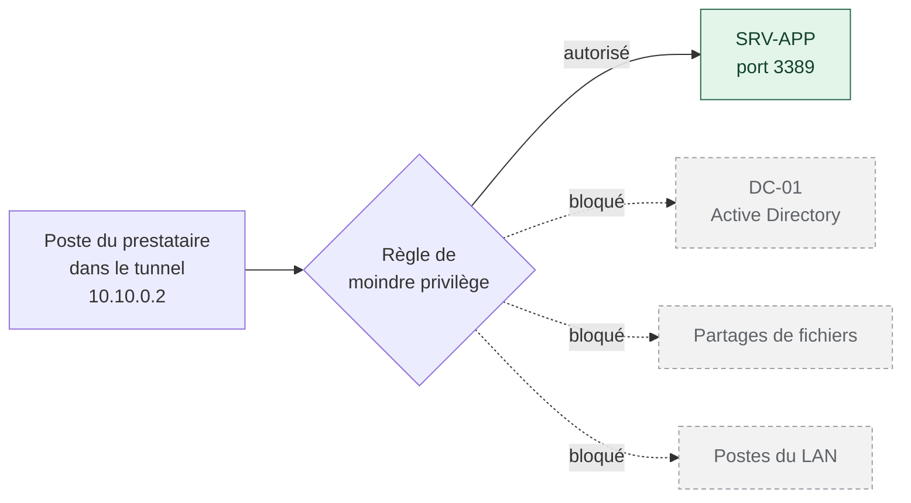

# Moindre privilège et confinement

> Les noms de domaine, de machines, de comptes et de tiers qui apparaissent ici sont fictifs. Les captures proviennent d'un laboratoire.

## Le raisonnement

Le tunnel résout le problème de l'exposition. Il ne résout pas celui de la confiance.

Un poste compromis chez le prestataire ouvre un tunnel parfaitement légitime : le bon certificat, le bon mot de passe, la bonne adresse. Du point de vue du VPN, rien ne distingue cette connexion d'une intervention normale. C'est le scénario SO4 de l'analyse, celui dont le risque résiduel a été accepté.

Puisqu'on ne peut pas empêcher cette connexion, il faut limiter ce qu'elle permet d'atteindre.

## Les deux règles

Sur l'interface WAN, une seule règle entrante : le port du VPN. Le port 3389 qui était redirigé vers le serveur a été supprimé. Aucun service applicatif n'est plus joignable directement depuis Internet.

Sur l'interface du VPN, la règle permissive créée par défaut a été remplacée par deux règles explicites, dans cet ordre :

| Ordre | Source | Destination | Port | Action |
|---|---|---|---|---|
| 1 | 10.10.0.2 (poste du prestataire) | 10.0.0.150 (serveur applicatif) | TCP 3389 | Autoriser |
| 2 | 10.10.0.0/24 (tout le VPN) | Toute destination | Tout | Bloquer |

L'ordre compte. Le pare-feu applique la première règle qui correspond : la permission précise d'abord, le blocage général ensuite. Inversées, elles bloqueraient tout.

**Une seule source, une seule destination, un seul port.** C'est le moindre privilège appliqué littéralement. Le prestataire obtient l'accès dont son travail a besoin, et strictement rien d'autre.

> *Capture : règles de filtrage sur l'interface VPN*

## Ce que cela change concrètement

Un attaquant qui contrôle le poste du prestataire se retrouve dans un couloir. Il peut atteindre une machine, sur un port. Il ne peut pas balayer le réseau local, ni interroger l'annuaire, ni se déplacer latéralement vers d'autres serveurs.

Cela ne rend pas l'attaque impossible. Cela la rend beaucoup plus lente et beaucoup plus bruyante, ce qui laisse à la détection le temps de servir à quelque chose.

## Preuve : le confinement fonctionne

Depuis le poste du prestataire connecté au VPN, j'ai tenté un ping vers le contrôleur de domaine. La requête n'aboutit pas : elle est bloquée par la seconde règle.

C'est le test le plus parlant de ce chapitre. Le tunnel est ouvert, l'authentification a réussi, la session RDP fonctionne, et pourtant le reste du réseau reste hors de portée.

> *Capture : ping vers le contrôleur de domaine depuis le poste du prestataire, sans réponse*

## Pourquoi l'adresse fixe était nécessaire

Cette règle ne tient que parce que l'adresse du prestataire est prévisible. C'est le rôle du *Client Specific Override* décrit au chapitre précédent.

Sans lui, le serveur VPN attribuerait une adresse quelconque du sous-réseau, et la seule règle possible serait « tout le sous-réseau VPN vers le serveur applicatif ». Cela resterait mieux que rien, mais chaque client VPN ajouté hériterait automatiquement de cet accès.

Avec une adresse par client, chaque prestataire peut recevoir sa propre règle. L'architecture reste valable si un deuxième intervenant extérieur arrive demain.

## Les limites

Le confinement protège le réseau. Il ne protège pas le serveur applicatif lui-même, qui reste accessible sur son port 3389 depuis le tunnel. Un attaquant qui dispose d'une session RDP valide est sur cette machine, avec les droits du compte.

C'est précisément pourquoi le compte du prestataire a été créé sans droits d'administration et sans accès aux partages, et pourquoi la suite du projet porte sur la détection plutôt que sur le blocage.

C'est aussi pourquoi le bilan du projet propose d'isoler le service de gestion du froid sur une machine distincte. Tant qu'il partage le serveur avec la base de données métier et les fichiers, le couloir mène à une pièce qui contient beaucoup plus que ce que le prestataire a besoin de voir.

## Transposition en production

Les mêmes deux règles s'écrivent dans l'interface du pare-feu de production, avec la même logique d'ordre. La notion d'adresse fixe par utilisateur VPN existe également. Rien dans ce chapitre ne dépend du produit utilisé en laboratoire.

---

Précédent : [VPN, PKI et authentification mutuelle](02-vpn-mtls.md) · Suivant : [IPS et règles de détection](04-ips.md)
