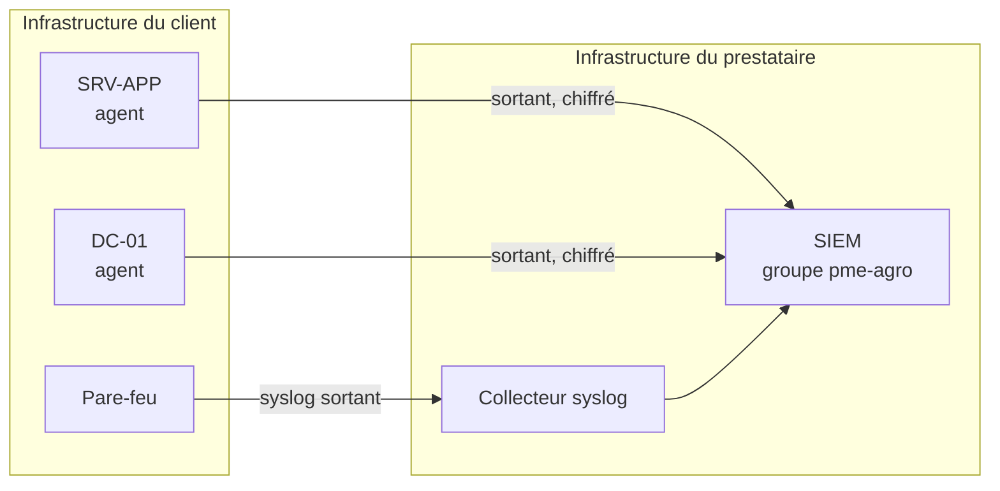

# SIEM, règles locales et réponse active

> Les noms de domaine, de machines, de comptes et de tiers qui apparaissent ici sont fictifs. Les captures proviennent d'un laboratoire.

## L'architecture retenue

Le SIEM est celui du prestataire d'infogérance, hébergé chez lui et mutualisé entre ses clients. Le modèle est donc celui d'un service géré, avec une conséquence structurante : **tous les flux partent de chez le client vers le prestataire. Aucun port entrant n'est ouvert pour le SIEM.**



Trois sources alimentent le SIEM : les deux serveurs Windows par leur agent, et le pare-feu par syslog.

Les deux agents sont placés dans un groupe dédié au client, ce qui isole ses alertes et ses configurations de celles des autres clients du prestataire et permet d'appliquer une politique en une opération.

> *Capture : liste des agents, statut actif, groupe pme-agro*

## Journaux du pare-feu

Le pare-feu envoie ses journaux en syslog vers le collecteur du prestataire, qui les écrit dans un fichier dédié. Le SIEM lit ensuite ce fichier.

```
# /etc/rsyslog.d/pare-feu.conf
module(load="imudp")
input(type="imudp" port="5140")

if $fromhost-ip == '192.168.1.88' then /var/log/pare-feu.log
& stop
```

```xml
<localfile>
  <log_format>syslog</log_format>
  <location>/var/log/pare-feu.log</location>
</localfile>
```

Ce montage a un intérêt au-delà de la collecte : il est indépendant du modèle de pare-feu. En production, c'est le pare-feu du client qui envoie vers le même collecteur, sur le même port, dans le même fichier. Rien ne change côté prestataire.

> *Capture : configuration du syslog distant sur le pare-feu*
> *Capture : configuration du collecteur syslog*

## Les règles locales

Trois règles couvrent le contexte de ce client.

C'est ici qu'est détecté le brute-force, et non dans l'IPS : ces règles s'appuient sur l'événement 4625 de Windows, « échec d'ouverture de session », qui est la seule trace fiable d'une tentative de mot de passe.

```xml
<group name="pme-agro,">

  <!-- 100001 : echecs d'authentification repetes depuis la meme source -->
  <!-- Se declenche apres 10 echecs en 2 minutes -->
  <rule id="100001" level="12" frequency="10" timeframe="120">
    <if_matched_sid>60122</if_matched_sid>
    <description>PME-AGRO -- Tentatives d'authentification repetees depuis la meme source</description>
    <mitre><id>T1110</id></mitre>
    <group>authentication_failures,pci_dss_11.4,</group>
  </rule>

  <!-- 100002 : tentative sur le compte du prestataire, alerte maximale -->
  <!-- Pas de blocage automatique, voir plus bas -->
  <rule id="100002" level="15">
    <if_sid>60122</if_sid>
    <field name="win.eventdata.targetUserName">clim-froid</field>
    <description>PME-AGRO CRITIQUE -- Tentative d'authentification sur le compte du prestataire</description>
    <mitre><id>T1110</id></mitre>
    <group>authentication_failures,pci_dss_11.4,</group>
  </rule>

  <!-- 100003 : service de supervision du froid arrete -->
  <!-- Deuxieme couche de surveillance de VM1 -->
  <rule id="100003" level="14">
    <if_sid>61100</if_sid>
    <field name="win.system.eventID">^7036$</field>
    <field name="win.eventdata.param1">FrigoMonitor</field>
    <description>PME-AGRO CRITIQUE -- Service de supervision du froid arrete</description>
  </rule>

</group>
```

<!-- À VALIDER : les identifiants de règles parentes dépendent de la version du jeu de règles. 60122 couvre l'événement Windows 4625, échec d'ouverture de session ; 61100 couvre les événements du gestionnaire de services. À confirmer avec un test de journal avant mise en production. -->

## Une précision sur l'événement 7036

Le message de cet événement porte l'état du service en toutes lettres, dans la langue du système : « running » ou « stopped » sur un Windows anglais, « en cours d'exécution » ou « arrêté » sur un Windows français.

Filtrer sur cet état rendrait la règle dépendante de la langue du serveur. Je filtre donc sur le nom du service seul, quitte à recevoir aussi l'alerte au démarrage. Ce n'est pas gênant : un service de supervision du froid qui redémarre mérite aussi qu'on le sache.

## La réponse active, et la décision de ne pas en mettre partout

La règle 100001 déclenche un blocage automatique de l'adresse source.

```xml
<active-response>
  <command>netsh</command>
  <location>local</location>
  <rules_id>100001</rules_id>
  <timeout>600</timeout>
</active-response>
```

**Le choix de la commande.** `netsh.exe` est le script de réponse active prévu pour les agents Windows ; il ajoute une règle de blocage dans le pare-feu de l'hôte. Les commandes `firewall-drop` et `firewalld-drop`, plus souvent citées, sont réservées aux agents Linux, macOS et Unix.

**Ce que `location local` implique.** La réponse s'exécute sur l'agent qui a généré l'alerte, donc sur le serveur Windows concerné. Le blocage a lieu sur le pare-feu de cette machine, pas sur le pare-feu de périmètre. L'attaquant ne peut plus atteindre ce serveur, mais il reste joignable ailleurs sur le réseau. Bloquer au périmètre supposerait que le SIEM pilote le pare-feu, ce qui n'est pas le cas dans cette architecture.

C'est une limite réelle, et elle est acceptable ici : le serveur visé est précisément celui qu'il faut protéger, et l'IPS couvre déjà le périmètre.

**Et surtout, la règle 100002 ne déclenche aucun blocage.** C'est un choix délibéré, et c'est le point le plus intéressant de ce chapitre.

Si toute adresse tentant de s'authentifier avec le compte du prestataire était bloquée automatiquement, il suffirait d'une seule tentative échouée depuis l'adresse légitime du prestataire pour que le SIEM la bloque lui-même. Le frigoriste se retrouverait dehors. Le mécanisme de protection deviendrait le vecteur d'attaque, exactement comme la politique de verrouillage de compte dans le scénario SO3.

La règle génère donc une alerte de niveau maximal, transmise immédiatement au prestataire. Un technicien analyse et décide.

L'accès malveillant reste très difficile par ailleurs : la politique de verrouillage du domaine stoppe toute attaque de mot de passe après quelques échecs, et l'authentification par certificat rend l'ouverture du tunnel impossible sans le certificat du prestataire.

## Correspondance MITRE ATT&CK

| Technique | Ce qu'elle couvre | Où elle apparaît |
|---|---|---|
| T1110 | Attaque sur les identifiants par essais répétés | Règles 100001 et 100002 |
| T1531 | Suppression de l'accès d'un compte légitime | Verrouillage du compte du prestataire, détecté par le jeu de règles standard |

T1531 est la traduction exacte, dans le vocabulaire de MITRE, du scénario SO3 de l'analyse de risques : priver un compte légitime de son accès. Le fait que la technique existe dans le référentiel confirme que ce n'était pas une inquiétude théorique.

## Preuve : la séquence d'une attaque

Depuis la machine de test, une suite de tentatives d'authentification sur le compte du prestataire produit dans le SIEM la chronologie complète :

- plusieurs alertes de la règle 100002, niveau 15, rattachées à T1110, en temps réel ;
- puis la détection du verrouillage du compte, rattachée à T1531 ;
- les deux serveurs Windows remontent l'événement, et les alertes sont corrélées.

Le délai entre la première tentative et la première alerte est inférieur à trente secondes.

> *Capture : alertes de la règle 100002 avec la technique MITRE visible*
> *Capture : détection du verrouillage du compte*
> *Capture : vue d'ensemble corrélant les deux serveurs et le pare-feu*

## Transposition en production

Les règles locales et la réponse active s'appuient sur les événements Windows remontés par les agents. Elles sont indépendantes du pare-feu et ne changent pas d'un environnement à l'autre.

La seule différence tient à la source syslog : en production, c'est le pare-feu du client qui émet, vers le même collecteur et le même fichier. La configuration côté prestataire reste identique.

---

Précédent : [IPS et règles de détection](04-ips.md) · Suivant : [Supervision indépendante de la chaîne du froid](06-alerte-chaine-du-froid.md)
