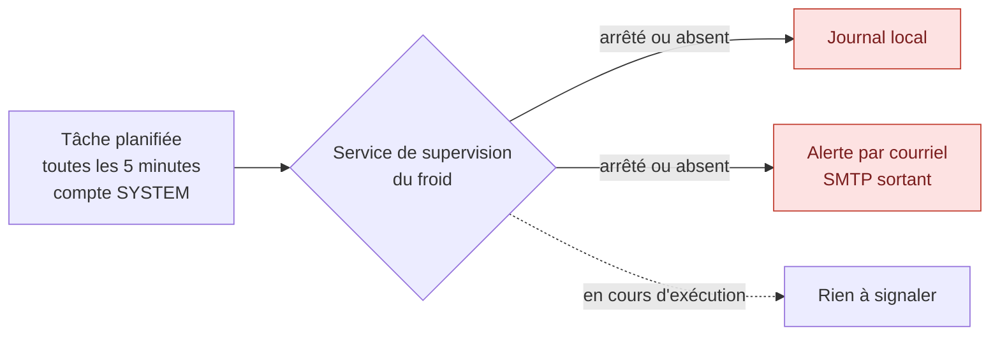

# Supervision indépendante de la chaîne du froid

> Les noms de domaine, de machines, de comptes et de tiers qui apparaissent ici sont fictifs. Les captures proviennent d'un laboratoire.

## Pourquoi ce mécanisme existe

Fermer l'accès RDP direct a réglé le problème de sécurité. Il en a créé un autre, et c'est le genre d'effet qu'on ne voit qu'en déroulant les conséquences jusqu'au bout.

Le prestataire frigoriste était averti des pannes par le logiciel auquel il accédait en RDP. En supprimant cet accès permanent, on supprime aussi le chemin par lequel l'alerte lui parvenait.

À cela s'ajoute le scénario SO3 de l'analyse : un attaquant qui fait verrouiller le compte du prestataire prive la chaîne du froid de toute surveillance humaine. La mesure de protection produit l'incident qu'elle devait éviter.

Il fallait donc un mécanisme qui ne dépende **ni du compte du prestataire, ni du tunnel VPN, ni d'une intervention humaine**. Quelque chose qui continue de fonctionner quand tout le reste a échoué.

## Ce que ce script fait, et ce qu'il ne fait pas

Il ne protège rien. Il ne bloque rien. Il regarde si un service tourne, et il envoie un courriel quand ce n'est plus le cas.

C'est exactement son intérêt. Sa valeur ne vient pas de sa sophistication, elle vient de son indépendance. Un mécanisme simple qui survit à la panne des autres vaut mieux qu'un mécanisme élaboré qui tombe avec eux.



Le seul flux réseau est une connexion sortante vers le serveur de messagerie. Aucun port entrant supplémentaire n'est nécessaire.

## Les identifiants SMTP

Le script a besoin du mot de passe du compte d'envoi. Il n'a pas besoin de le contenir.

Écrire un mot de passe dans un script le rend lisible par quiconque peut lire le fichier : toute personne disposant d'un accès au serveur, mais aussi toute copie de sauvegarde de cette machine, y compris les copies immuables qu'on ne peut plus modifier. Dans un projet dont le scénario résiduel assumé est précisément « un attaquant obtient une session sur ce serveur », c'est une credential offerte.

Les identifiants sont donc créés une fois par un script séparé, chiffrés, et lus à l'exécution :

```powershell
# Création, une seule fois
Get-Credential | Export-Clixml -Path 'C:\Scripts\smtp.cred.xml'

# Lecture, à chaque exécution
$identifiants = Import-Clixml -Path 'C:\Scripts\smtp.cred.xml'
```

`Export-Clixml` chiffre le mot de passe avec DPAPI, le mécanisme de protection des données de Windows. La clé dérive du compte et de la machine : le fichier n'est déchiffrable que **par ce compte, sur cette machine**. Copié ailleurs, restauré depuis une sauvegarde sur un autre serveur, ou récupéré seul, il ne donne rien.

**La limite, pour être exacte.** DPAPI ne protège pas contre quelqu'un qui exécute déjà du code sous le même compte sur cette machine : il peut déchiffrer, puisque c'est ce que fait le script. Ce que DPAPI écarte, c'est le fichier copié, la sauvegarde lue ailleurs, le script partagé, et le dépôt de code.

**Un piège qui en découle.** Si la tâche planifiée s'exécute sous le compte SYSTEM, le fichier doit avoir été créé sous SYSTEM. Un fichier créé sous un compte d'administration ne sera pas lisible par SYSTEM, et l'envoi échouera sans raison apparente. Le script d'initialisation affiche le compte courant au lancement, précisément pour éviter cette erreur.

**Et en production, le mieux serait de ne pas avoir de mot de passe du tout.** Un relais SMTP interne qui accepte le serveur sur son adresse IP supprime la question : plus de credential à protéger, nulle part. Dans une PME suivie par un prestataire d'infogérance, ce relais existe en général.

Le fichier d'identifiants est exclu du dépôt par le `.gitignore`.

## Les scripts

- [`AlerteChaineFroid.ps1`](../scripts/AlerteChaineFroid.ps1) — la vérification et l'alerte
- [`Initialiser-Identifiants.ps1`](../scripts/Initialiser-Identifiants.ps1) — la création du fichier chiffré, à lancer une fois

Quelques choix de conception, visibles dans le code :

**Un service absent est traité différemment d'un service arrêté.** Un service qui n'existe plus a été désinstallé ou renommé, ou bien le nom surveillé est faux. Dans les trois cas, la supervision ne fonctionne plus et le message doit le dire.

**Le journal n'est écrit qu'en cas d'anomalie.** Une ligne toutes les cinq minutes pour dire que tout va bien rendrait le fichier illisible le jour où il faut le relire.

**Un journal inaccessible n'interrompt pas l'envoi du courriel.** L'alerte compte plus que sa trace locale.

**Les échecs d'envoi sont journalisés et le script sort en code d'erreur.** Le planificateur de tâches conserve ce code, ce qui rend l'échec visible dans son historique.

## La tâche planifiée

| Onglet | Réglage |
|---|---|
| Général | Compte SYSTEM, exécuter même si l'utilisateur n'est pas connecté |
| Déclencheurs | Répéter toutes les 5 minutes, indéfiniment |
| Actions | `powershell.exe -NonInteractive -ExecutionPolicy Bypass -File C:\Scripts\AlerteChaineFroid.ps1` |

> *Capture : planificateur de tâches, fréquence et compte d'exécution*

## Le service surveillé

En production, il s'agit du service Windows fourni par le fabricant du système de réfrigération.

En laboratoire, j'ai créé un service portant le même nom à l'aide d'un gestionnaire de services qui transforme un exécutable quelconque en service Windows. Cela permet de l'arrêter et de le redémarrer à volonté pour éprouver le mécanisme.

> *Capture : console des services, service de supervision en cours d'exécution*

## Preuve : le déclenchement

J'ai arrêté manuellement le service. En moins de cinq minutes, le courriel d'alerte est arrivé sur la boîte de test et la ligne correspondante a été écrite dans le journal.

> *Capture : courriel d'alerte reçu, horodatage visible*
> *Capture : contenu du journal*

## La deuxième couche

Ce script n'est pas seul à surveiller ce service. La règle 100003 du SIEM détecte le même arrêt, par un autre chemin : l'événement Windows du gestionnaire de services, remonté par l'agent.

Les deux mécanismes sont indépendants. Le script dépend du planificateur de tâches et du serveur de messagerie. La règle du SIEM dépend de l'agent et de la liaison vers le prestataire. Une panne de l'un ne touche pas l'autre.

Pour une valeur métier classée critique, deux chemins de détection distincts ne sont pas un luxe.

## Ce que ce chapitre dit du projet entier

Le script d'alerte est né d'une erreur découverte en testant, pas d'une idée sur le papier.

En simulant une attaque de mot de passe sur le compte du prestataire, j'ai déclenché deux scénarios à la fois : les tentatives répétées, et le verrouillage du compte. La politique de verrouillage, conçue pour protéger, produisait exactement le risque qu'elle devait écarter.

La défense en profondeur n'est pas une addition de solutions. C'est leur interaction qui détermine le niveau de protection réel, et cette interaction ne se voit qu'en éprouvant l'ensemble.

---

Précédent : [SIEM, règles locales et réponse active](05-siem-wazuh.md) · Suivant : [Octobre et novembre 2026](07-chaine-du-froid-2026.md)
