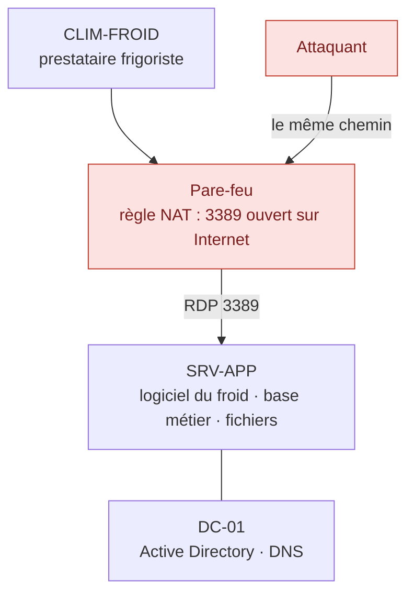
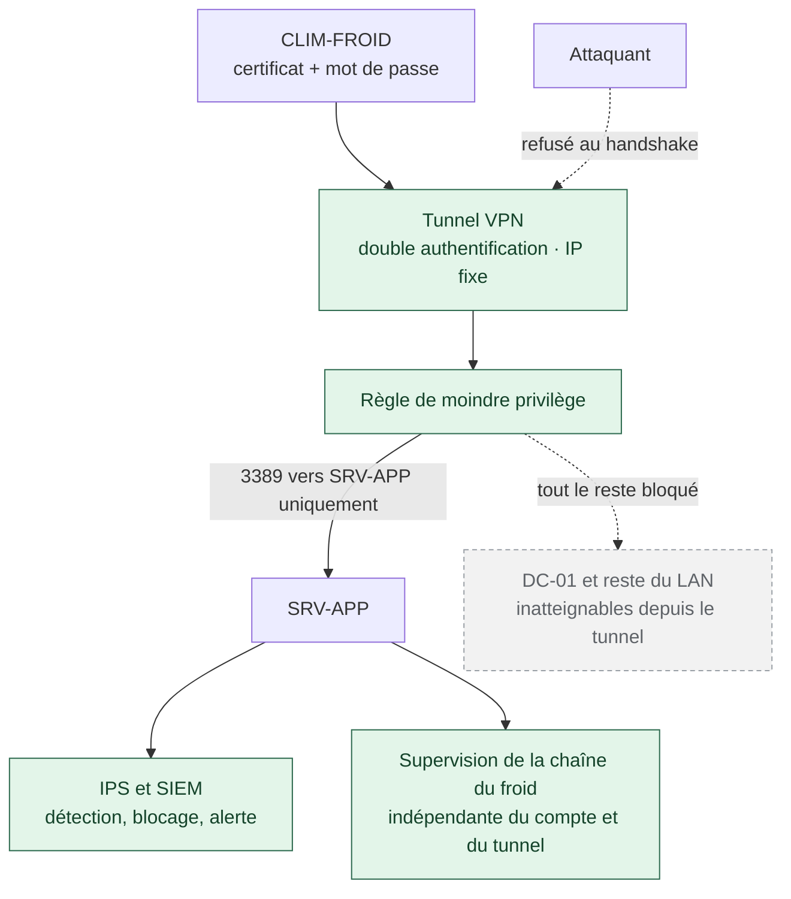

# Sécurisation de l'accès distant d'un prestataire à une PME agroalimentaire

Projet présenté le **31 mars 2026** devant le jury de la session d'examen du certificat de compétences professionnelles **« Participer à la gestion de la cybersécurité » (CP-003144)**, constitutif du titre professionnel d'Administratrice d'Infrastructures Sécurisées. Centre agréé ADRAR Formation, Toulouse. Certificat délivré le 24 avril 2026.

Le sujet ne m'a pas été donné. Il vient d'une observation faite pendant mon stage, chez un client du prestataire d'infogérance qui m'accueillait.

## Pourquoi je publie ce projet maintenant

En mars 2026, cette analyse plaçait **la chaîne du froid comme la valeur métier la plus critique** d'une PME agroalimentaire, devant les données personnelles et l'application de gestion. Elle décrivait comment un accès distant mal protégé pouvait la priver de toute surveillance, et pourquoi le service frigorifique lui-même constituait une surface d'attaque, et pas seulement le chemin qui y mène.

En octobre et novembre 2026, des attaques ont visé les systèmes de réfrigération de centaines de sites en France. Parmi les cibles : des enseignes de la grande distribution, mais aussi des boucheries, un abattoir, des usines coopératives agroalimentaires, puis les réserves de l'Établissement français du sang.

**Je n'avais rien prédit.** J'avais constaté qu'une attaque de ce type était possible, à partir d'un cas réel, et je l'avais écrit. C'est cette ressemblance qui m'a décidée à publier ce travail.

Le dépôt se lit donc dans les deux sens : l'analyse et les mesures telles qu'elles ont été remises en mars, et une relecture à la lumière de ce qui s'est produit ensuite, y compris ce que mon périmètre n'avait pas couvert.

→ [Octobre et novembre 2026 : ce que les attaques sur la chaîne du froid ont confirmé](docs/07-chaine-du-froid-2026.md)

---

> **Aucun nom réel ne figure dans ce dépôt.**
>
> Le client n'est pas nommé, et ne le sera pas. Tous les noms qui apparaissent ici sont fictifs : le prestataire frigoriste, le domaine, les machines, les comptes, les certificats. Les adresses IP sont celles d'un laboratoire, et les identifiants ont été retirés. Les captures proviennent de ce laboratoire, reconstruit pour la documentation.
>
> Ce dépôt documente une démarche et des choix techniques, pas une entreprise.

Chaque étiquette mène au chapitre correspondant.

---

## Avant et après, en un schéma

**Avant.** Le prestataire frigoriste et un attaquant empruntent exactement le même chemin.

**Après.** Le port 3389 n'existe plus depuis Internet. Le prestataire garde l'accès dont il a besoin, et rien de plus.

---

## L'observation

Janvier 2026. Je suis en stage chez un prestataire d'infogérance toulousain et je participe à la modernisation de l'infrastructure d'une PME agroalimentaire sans informaticien interne. Nouveau serveur, Hyper-V, migration de l'Active Directory vers Windows Server 2025, sauvegarde Acronis. Une mission classique de technicienne systèmes et réseaux, menée en binôme avec un technicien senior.

La migration terminée, je relis la configuration du pare-feu. Une règle NAT redirige le port 3389 depuis Internet directement vers le serveur. Le prestataire frigoriste, celui qui intervient sur le logiciel de gestion de la chambre froide, se connecte par là. En RDP direct, sans tunnel, sans authentification renforcée.

Sa connexion emprunte exactement le même chemin que celle d'un attaquant.

C'est une configuration déconseillée depuis longtemps : le CERT-FR a publié une alerte sur l'exposition directe du RDP, et l'ANSSI recommande un VPN avec authentification forte pour tout accès distant. Le serveur venait d'être migré, mais le vecteur d'entrée, lui, n'avait pas bougé.

J'ai proposé au responsable du prestataire de conduire une analyse de risques structurée et de construire les mesures correctives. Ce projet est le résultat de cette initiative.

## Le renversement

En commençant l'analyse, je suis partie de la question habituelle : quelles données faut-il protéger ? Données RH des salariés, clients e-commerce, paiements par carte. Le RGPD, le PCI DSS, tout pointait vers les données.

Puis j'ai posé la question autrement : qu'est-ce qui arrête cette entreprise ?

Ce n'est pas la fuite d'un fichier RH. C'est la chambre froide. Une entreprise dont l'activité repose sur le froid et qui perd sa chaîne du froid perd sa marchandise, ses livraisons et ses contrats. L'activité s'arrête le jour même.

Dans mon analyse, la chaîne du froid devient donc **VM1, valeur métier CRITIQUE**, au-dessus des données commerciales, des données personnelles et de l'ERP.

Ce classement change tout ce qui suit. Il déplace le scénario le plus grave : ce n'est pas le vol de données, c'est **SO3**, le verrouillage du compte du frigoriste. Un attaquant qui enchaîne les tentatives d'authentification fait verrouiller le compte par la politique du domaine. Le frigoriste ne peut plus intervenir. La chambre froide tourne sans personne pour la surveiller.

Autrement dit : la mesure de sécurité qui protège le compte peut elle-même produire l'incident le plus grave. Je ne l'ai pas vu en théorie, je l'ai vu en simulant l'attaque.

| | Scénario | Pourquoi il compte |
|---|---|---|
| SO1 | Reconnaissance sur le port RDP | Nom de domaine, nom du serveur et version de Windows obtenus sans authentification |
| SO2 | Brute-force RDP | Port joignable 24 h sur 24 depuis Internet, sans blocage réseau |
| SO3 | Verrouillage du compte frigoriste | **Prioritaire.** Impacte directement VM1 |
| SO4 | Poste du frigoriste compromis | La connexion devient indiscernable d'un accès légitime |

Détail de l'analyse, cadre légal et matrice : [contexte et analyse de risques](docs/01-analyse-de-risques.md)

## Ce que j'ai construit

Une défense en couches, sur les équipements déjà en place. Aucun achat matériel. Cette contrainte était posée dès le départ, et j'y reviens plus bas.

**Fermer le vecteur.** Le port 3389 disparaît d'Internet. Le serveur devient invisible depuis l'extérieur. Le frigoriste passe désormais par un tunnel VPN avec deux facteurs exigés simultanément : un certificat client émis par une autorité interne, et le mot de passe de son compte de domaine. Les deux, ou rien. Le nom du certificat doit correspondre exactement au compte qui se connecte. Une liste de révocation permet de couper l'accès en une opération si le poste est perdu ou volé.
→ [VPN, PKI et authentification mutuelle](docs/02-vpn-mtls.md)

**Ne pas faire confiance au tunnel.** Un poste compromis peut ouvrir un tunnel parfaitement légitime. Une fois connecté, le frigoriste ne peut atteindre qu'une seule destination : le port 3389 du serveur applicatif. Tout le reste du réseau local lui est fermé, y compris le contrôleur de domaine.
→ [Moindre privilège et confinement](docs/03-moindre-privilege.md)

**Voir ce qui arrive.** Un IPS en périphérie, avec quatre règles écrites pour ce contexte : scan du port RDP, tentatives de connexion répétées, balayage ICMP, scan SYN multi-ports. Détection, puis blocage automatique de la source.
→ [IPS et règles de détection](docs/04-ips.md)

**Corréler.** Le SIEM du prestataire centralise les journaux des deux serveurs Windows et du pare-feu. Trois règles personnalisées, rattachées aux techniques MITRE ATT&CK T1110 et T1531. Une réponse active bloque automatiquement l'adresse source en cas de brute-force.

Avec une exception assumée : la règle qui surveille le compte du frigoriste ne déclenche **pas** de blocage automatique. Sinon il suffirait d'une seule tentative échouée depuis l'adresse légitime du frigoriste pour que le SIEM la bloque lui-même. Le mécanisme de protection deviendrait le vecteur d'attaque. Cette règle génère une alerte de niveau 15, transmise à un technicien qui décide.
→ [SIEM, règles locales et réponse active](docs/05-siem-wazuh.md)

**Garder un œil sur la chambre froide, quoi qu'il arrive.** Fermer le RDP supprime aussi le moyen par lequel le frigoriste était averti des pannes. Il fallait un mécanisme qui ne dépende ni de son compte, ni du VPN, ni d'une intervention humaine. Un script PowerShell vérifie le service de supervision toutes les cinq minutes par tâche planifiée et envoie une alerte par courriel. Il ne protège rien. Il prévient. C'est précisément son intérêt : il fonctionne même quand tout le reste a échoué.
→ [Supervision indépendante de la chaîne du froid](docs/06-alerte-chaine-du-froid.md)

## Avant et après

Les mesures ont été validées en rejouant les mêmes attaques depuis une machine Kali, avant et après.

| Test | Avant | Après |
|---|---|---|
| Visibilité du port RDP depuis Internet | Ouvert | Filtré |
| Reconnaissance sans authentification | Domaine, serveur et version de Windows exposés | Aucune information |
| Connexion sans identifiants | Acceptée | Impossible |
| Brute-force | Aucun blocage réseau | Impossible sans tunnel authentifié |
| Tunnel VPN sans certificat | Sans objet | Refusé au handshake |
| Détection | Aucune | Moins de 30 secondes dans le SIEM |

## Ce que je n'ai pas traité, et pourquoi

Le logiciel de gestion du froid tourne sur le serveur applicatif, celui qui porte aussi la base de données et les fichiers partagés. C'est une faiblesse, et je l'ai écrite dans le bilan : le bon dispositif serait d'isoler ce service, d'abord dans une machine virtuelle dédiée, puis sur une machine physique dans un segment réseau séparé.

Les deux sont restés des propositions. Le projet avait une contrainte explicite : aucun investissement matériel supplémentaire.

Ce n'est pas une facilité. C'est la situation ordinaire d'une PME. Le budget informatique va vers ce qui est visible et vers ce qui tombe en panne. Isoler un service qui fonctionne, pour un risque qui ne s'est pas encore produit, demande une dépense que la direction ne perçoit pas comme urgente. J'ai donc fait ce qui était possible avec l'existant, et j'ai documenté le reste comme un risque résiduel accepté.

C'est le point sur lequel le jury m'a interrogée. Ma réponse n'a pas changé : une analyse de risques ne sert pas seulement à choisir des mesures, elle sert à écrire ce qu'on décide de ne pas traiter, pour que la décision soit consciente et puisse être revue quand le contexte change.

## Ce que la simulation m'a appris

Le test le plus utile n'est pas celui qui confirme qu'une mesure fonctionne. C'est celui qui montre qu'une mesure en casse une autre.

En simulant le brute-force sur le compte du frigoriste, j'ai déclenché SO2 et SO3 en même temps. La politique de verrouillage, conçue pour protéger le compte, produisait exactement le risque qu'elle devait éviter : la chaîne du froid sans supervision. C'est ce constat qui a motivé le script d'alerte comme mesure compensatoire.

La défense en profondeur n'est pas une addition de solutions. C'est leur interaction qui détermine le niveau de protection réel.

## Octobre et novembre 2026

Sept mois après la remise de ce dossier, des attaques ont visé les systèmes de réfrigération d'environ 700 supermarchés en France, puis de trois sites de l'Établissement français du sang. Dégivrage forcé pendant la nuit, températures jusqu'à 80 °C, équipements détruits, dizaines de millions d'euros de pertes.

Le point d'entrée n'était pas celui de mon projet. Les attaquants ont visé les automates de régulation frigorifique, dont le serveur web était exposé directement sur Internet, souvent avec un identifiant constructeur et un mot de passe dérivé de la date.

Ce que ces attaques confirment, c'est le classement par lequel j'ai commencé : dans une entreprise dont l'activité dépend du froid, la valeur métier critique n'est pas la base de données. C'est la chambre froide. À l'EFS, ce sont la supervision et les alarmes qui ont permis d'intervenir avant la perte des produits.

Ce qu'elles ajoutent à mon analyse : mon inventaire s'arrêtait aux serveurs. Les automates eux-mêmes, avec leur version, leur fin de support et leur accès réseau propre, n'y figuraient pas.

→ [Relecture du projet à la lumière de ces attaques](docs/07-chaine-du-froid-2026.md)

## Note sur le laboratoire

Le pare-feu du client n'était pas disponible en environnement de laboratoire. J'ai reconstruit l'architecture avec pfSense, OpenVPN et Snort, qui reproduisent les mêmes fonctions. Les configurations sont transposables sur l'équipement de production, et chaque chapitre précise ce qui change.

## Documentation

1. [Contexte, cadre légal et analyse de risques](docs/01-analyse-de-risques.md)
2. [VPN, PKI et authentification mutuelle](docs/02-vpn-mtls.md)
3. [Moindre privilège et confinement](docs/03-moindre-privilege.md)
4. [IPS et règles de détection](docs/04-ips.md)
5. [SIEM, règles locales et réponse active](docs/05-siem-wazuh.md)
6. [Supervision indépendante de la chaîne du froid](docs/06-alerte-chaine-du-froid.md)
7. [Octobre et novembre 2026 : ce que les attaques sur la chaîne du froid ont confirmé](docs/07-chaine-du-froid-2026.md)
8. [Scripts PowerShell](scripts/)

---

Ana Paula Ramos Beiriz · Technicienne Supérieure Systèmes et Réseaux · Toulouse
[LinkedIn](https://linkedin.com/in/anapaulabeiriz)

